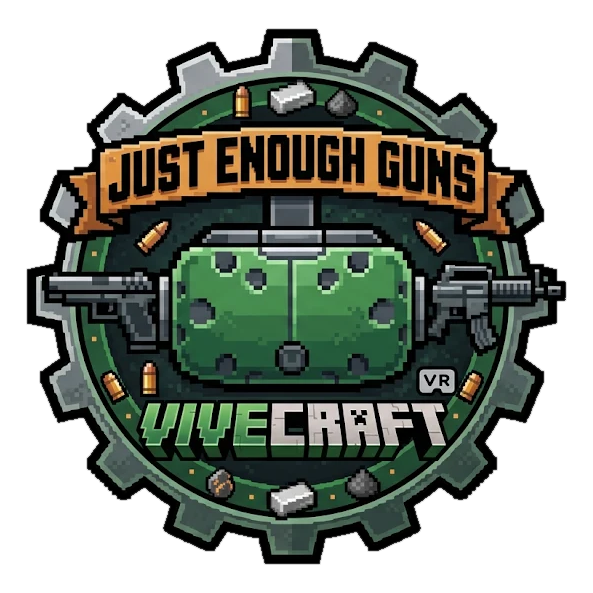

<p align="center"></p>

# Just Enough Guns VR (JEG x Vivecraft)

[English](README.md) · **Español**

Addon no oficial para Forge 1.20.1 que hace jugable [Just Enough Guns](https://modrinth.com/mod/just-enough-guns) en VR con
[Vivecraft](https://modrinth.com/mod/vivecraft), sin modificar ninguno de los dos. Sin VR no cambia nada.

## Requisitos

- Minecraft 1.20.1, Forge 47.2+
- Just Enough Guns 0.13.2, con Framework y GeckoLib
- Vivecraft 1.20.1-1.2.5

Se instala en el cliente. También en el servidor, suma las armas en la mano libre, las balas que salen de la boca del
arma, y deja que el servidor decida algunas opciones de VR (`serverconfig/jeg_vr_compat-server.toml` en la carpeta del
mundo).

Probado con unas Meta Quest 3 a través de SteamVR. Otros visores y runtimes deberían andar a través de Vivecraft,
pero no están probados: se agradecen los reportes.

## Cómo se usa

- **Disparar:** el gatillo de la mano que tiene el arma.
- **Recargar con la mano:** mano libre en la cadera, grip para tomar el cargador y tocar el arma con él.
- **Recargar con botón:** la tecla de recarga de JEG o el botón de apuntar. Con dos armas, la que apunta hacia arriba.
- **Modo precisión:** mano libre en el guardamanos de un arma a dos manos, y grip.
- **Cuerpo a cuerpo:** mover el arma con fuerza.
- **Opciones:** botón Config en la lista de mods. **Calibrar un arma:** `/jegvr help`.

## Compilar

Hace falta el JDK 17 (`JAVA_HOME`). Las dependencias vienen de repositorios públicos, así que un clon nuevo compila tal cual:

```bash
./gradlew build
```

El jar que se usa es `build/libs/jeg_vr_compat-<versión>.jar`. El `-slim` no trae MixinExtras.

| Tarea | Qué hace |
|---|---|
| `./gradlew runClient` | Cliente de prueba (sumá `-PnoVivecraft`, o `-Pcompat` para Embeddium y Oculus) |
| `./gradlew runClientAudit` | Aplica todos los mixins, anota los que fallan y cierra |
| `./gradlew checkMixins` | Revisa los nombres de los mixins contra los jars que tienen los jugadores (necesita Python) |
| `./gradlew test` | Pruebas de la matemática pura: ángulos de puntería, cajas de recarga y precisión, archivos de poses, caras espejadas |
| `tools/jegdiff.sh <jar viejo> <jar nuevo>` | Antes de soportar otra versión de JEG: qué clases y nombres de JEG que usa el addon cambiaron |

## Documentación

Los documentos del proyecto están en [`docs/`](docs/README.md): [compatibilidad](docs/COMPATIBILIDAD.md),
[comandos](docs/COMANDOS.md), [dos jugadores](docs/MULTIJUGADOR.md) y [pruebas](docs/TESTING.md).
Los cambios de cada versión están en el [changelog](CHANGELOG.md).

## Licencia

Este addon es software libre bajo la [Licencia Pública General de GNU](LICENSE), versión 3 o, si preferís, cualquier
versión posterior (`GPL-3.0-or-later`). Viene sin garantía.

El jar publicado incluye además [MixinExtras](https://github.com/LlamaLad7/MixinExtras) (MIT, su licencia va dentro de su
jar). Just Enough Guns, Vivecraft, Framework y GeckoLib son mods aparte, con sus propias licencias, y no van incluidos.
