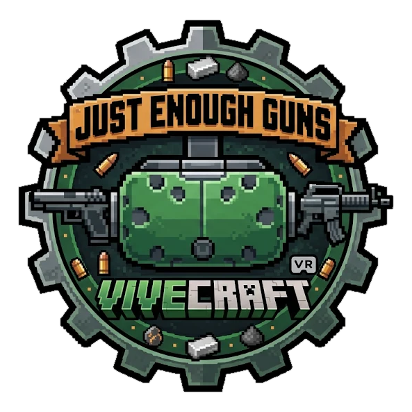

<p align="center"></p>

# Just Enough Guns VR (JEG x Vivecraft)

**English** · [Español](README.es.md)

Unofficial Forge 1.20.1 addon that makes [Just Enough Guns](https://modrinth.com/mod/just-enough-guns) playable in VR with
[Vivecraft](https://modrinth.com/mod/vivecraft), without changing either mod. Nothing changes for players without VR.

[](https://youtu.be/S7p8F--T0jE)

## Requirements

- Minecraft 1.20.1, Forge 47.2+
- Just Enough Guns 0.13.2 or 0.14.x, with Framework and GeckoLib
- Vivecraft 1.20.1-1.2.5 or 1.20.1-1.3.x

The same file works with any combination of those. JEG 0.14 and Vivecraft 1.3 are checked automatically but not yet
played through in VR.

Install it on the client. Also installed on the server, it adds off-hand guns and bullets that start at the muzzle,
and lets the server decide some VR options (`serverconfig/jeg_vr_compat-server.toml` in the world folder).

Tested with a Meta Quest 3 through SteamVR. Other headsets and runtimes should work through Vivecraft, but are untested:
reports are welcome.

## Using it

- **Shoot:** the trigger of the hand holding the gun.
- **Reload by hand:** free hand at the hip, grip to take a magazine, touch it to the gun.
- **Reload with a button:** JEG's reload key or aim button. With two guns, the one pointing up reloads.
- **Precision mode:** free hand on the handguard of a two-handed gun, then grip.
- **Melee:** swing the gun.
- **Options:** Config button in the mod list. **Calibrate a gun:** `/jegvr help`.

## Building

Needs JDK 17 (`JAVA_HOME`). Dependencies come from public repositories, so a fresh clone builds as it is:

```bash
./gradlew build
```

The jar to use is `build/libs/jeg_vr_compat-<version>.jar`. The `-slim` one lacks MixinExtras.

| Task | What it does |
|---|---|
| `./gradlew runClient` | Test client with the oldest supported JEG and Vivecraft (add `-Platest`, `-PlatestJeg` or `-PlatestVivecraft` for the newest, `-PnoVivecraft`, or `-Pcompat` for Embeddium and Oculus) |
| `./gradlew runClientAudit` | Applies every mixin, logs failures and closes (same options) |
| `./gradlew checkMixins` | Checks mixin names against the jars players have, for every supported version (needs Python) |
| `./gradlew checkMatrix` | Compiles against every supported combination of JEG and Vivecraft, then `checkMixins` |
| `./gradlew test` | Unit tests of the pure math: aim angles, reload and precision boxes, gun pose files, mirrored faces |
| `tools/jegdiff.sh <old jar> <new jar>` | Before supporting a new JEG: which JEG classes and names the addon uses changed |

## Documentation

The project documents are in [`docs/`](docs/README.md), in Spanish: [compatibility](docs/COMPATIBILIDAD.md),
[commands](docs/COMANDOS.md), [two-player setup](docs/MULTIJUGADOR.md) and [test checklist](docs/TESTING.md).
Changes per version are in the [changelog](CHANGELOG.md).

## License

This addon is free software under the [GNU General Public License](LICENSE), version 3 or (at your option) any later
version (`GPL-3.0-or-later`). It comes with no warranty.

The published jar also carries [MixinExtras](https://github.com/LlamaLad7/MixinExtras) (MIT, its license is inside its
jar). Just Enough Guns, Vivecraft, Framework and GeckoLib are separate mods with their own licenses, and are not included.
